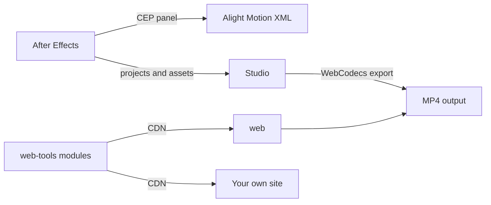

<div align="center">

  

  # OpenFishTools

  **Open-source motion graphics and video editing tools. Built for editors, runs in your browser.**

  <a href="https://github.com/openfishtools/Studio"></a>
  <a href="https://github.com/openfishtools/web"></a>
  <a href="https://github.com/openfishtools/CEP"></a>
  <a href="https://github.com/openfishtools/web-tools"></a>

</div>

---

> [!IMPORTANT]
> **Private by design.** Studio and Web Tools process media locally in your browser (WebCodecs, WebAssembly, WebGPU). Your files are never uploaded to a server.

## What we build

- **A real editor in a browser tab.** Multi-track timeline, keyframes, blend modes and an effect plugin registry, with no install.
- **Small tools that do one job well.** Compress, extract, convert, upscale, remove a background. Open, drop a file, done.
- **Native workflow helpers.** An After Effects panel for easing, auto save and conversion to Alight Motion.

---

## Showcase

### Studio: browser-based motion graphics editor

<div align="center">
  
</div>

<br />

<table>
  <tr>
    <td width="30%" align="center">
      
      <br /><sub><b>Mobile editor</b><br />Touch timeline and gesture controls</sub>
    </td>
    <td width="70%" valign="top">
      <h4>Highlights</h4>
      <ul>
        <li><b>Desktop suite</b> with docked inspector, track headers, playhead scrubbing and a curve graph editor.</li>
        <li><b>Mobile editor</b> with a viewport-adaptive canvas and gesture-driven timeline.</li>
        <li><b>Modular effects.</b> Each effect is one file registering to <code>FishEffectsRegistry</code>, with automatic parameter-to-timeline binding.</li>
        <li><b>Local export</b> through WebCodecs and MP4 muxing, with no cloud rendering.</li>
        <li><b>Zero-dependency dev server</b> with live reload and an optional tunnel.</li>
      </ul>
      <a href="https://github.com/openfishtools/Studio">Open the Studio repository</a>
    </td>
  </tr>
</table>

**Effect library preview**

<div align="center">
  
  
  
  
  
  
</div>

---

### Web Tools: creative utilities that run client-side

<div align="center">
  
</div>

| Tool | Category | What it does |
| :--- | :--- | :--- |
| **Remove Background** | AI | Video and image matting with MediaPipe, RVM and MODNet |
| **Media Upscaler** | AI | GPU-assisted upscale with selectable enhancement presets |
| **Video Compressor** | Video | Re-encode to a target size with FFmpeg WebAssembly |
| **Audio Extractor** | Video | Pull a clean MP3 out of any video |
| **Image Sequence to Video** | Video | Turn a ZIP of frames into a video, with optional audio |
| **Video Interpolation** | Video | Raise frame rate 2x, 4x or 8x |
| **AE to AM** | Converters | After Effects beat markers to Alight Motion XML |
| **5MB XML Generator** | Converters | Slim down Alight Motion projects safely |
| **Quality method** | TikTok | Patch and compress video for higher quality uploads |
| **TikTok Downloader / Statistics** | TikTok | Download without watermark, inspect metadata |

Every tool is a self-describing module. Load it from the CDN and run it in your own page, no clone needed:

```html
<script src="https://cdn.jsdelivr.net/gh/openfishtools/web-tools/video/audio-extractor-tool.js"></script>
```

See the [web-tools README](https://github.com/openfishtools/web-tools#readme) for the full integration guide.

---

### CEP: After Effects extension panel

<table>
  <tr>
    <td width="50%" valign="top">
      <h4>Graph Editor and Easing</h4>
      Interactive bezier handles, easing presets and an auto-apply toggle.
      <h4>AE to AM Converter</h4>
      Compositions to Alight Motion XML, with pre-comp embedding and optional expression baking.
    </td>
    <td width="50%" valign="top">
      <h4>Auto Save</h4>
      Background project backups with timestamped names.
      <h4>Layer and Transform Utilities</h4>
      Anchor grid, smart auto-crop, comp ratio and FPS changers, text animator presets.
    </td>
  </tr>
</table>

Installers for macOS (`.pkg`) and Windows (`.exe`) are on the [CEP releases page](https://github.com/openfishtools/CEP/releases).

---

## Ecosystem

| Repository | Stack | Status | Focus |
| :--- | :--- | :---: | :--- |
| [**Studio**](https://github.com/openfishtools/Studio) | JavaScript, Canvas, WebCodecs | `In Progress` | Text engine development |
| [**web**](https://github.com/openfishtools/web) | HTML, CSS, JavaScript | `In Progress` | Migrating tools to web-tools |
| [**web-tools**](https://github.com/openfishtools/web-tools) | JavaScript, FFmpeg.wasm, WebGPU | `Active` | Headless tool modules and CDN delivery |
| [**CEP**](https://github.com/openfishtools/CEP) | ExtendScript, CEP | `Stable` | Up to date, no active tasks |



---

## Contributing

1. Fork the repository you want to improve.
2. Create a branch and keep changes focused.
3. Open a pull request describing what changed and why.

All projects are released under the MIT License.

<div align="center">
  <sub>OpenFishTools</sub>
</div>
