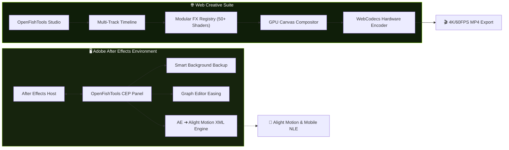

<div align="center">

  <a href="https://github.com/openfishtools">
    
  </a>

  # OpenFishTools

  <p align="center">
    <a href="https://github.com/openfishtools">
      
    </a>
  </p>

  <p align="center">
    <a href="https://github.com/openfishtools"></a>
    <a href="#-ecosystem--repositories"></a>
    <a href="#license"></a>
    <a href="https://github.com/cutefishaep"></a>
  </p>

  <p align="center">
    <a href="#-philosophy">Philosophy</a> •
    <a href="#-key-capabilities">Key Capabilities</a> •
    <a href="#-ecosystem--repositories">Ecosystem</a> •
    <a href="#-interactive-pipeline">Pipeline</a> •
    <a href="#-quickstart">Quickstart</a> •
    <a href="#-contributing">Contributing</a>
  </p>

</div>

---

> [!IMPORTANT]
> **100% Client-Side & Zero-Cloud Privacy**: OpenFishTools operates entirely on your local hardware. Video decoding, frame composition, shader rendering, and MP4 muxing occur in-browser via the WebCodecs API or natively inside Adobe After Effects. Your creative media never touches a third-party server.

---

## 💡 Philosophy

Traditional motion graphics and video editing software suffer from two major extremes: heavy, costly desktop software with proprietary locks, or web editors tethered to recurring cloud rendering subscription fees.

**OpenFishTools** eliminates this divide:
1. **Unconstrained Desktop Power**: Lightweight Adobe After Effects extension panels that automate curve easing, pre-comp management, and automated background backups.
2. **True Native Web Video Editing**: A non-linear editor (NLE) operating directly in the browser with desktop-grade track hierarchies, timeline keyframing, and zero cloud render lag.
3. **Cross-Platform Interoperability**: Seamless translation from desktop After Effects compositions into mobile animation formats (Alight Motion XML).

---

## ⚡ Key Capabilities

<table width="100%">
  <tr>
    <td width="50%" valign="top">
      <h3>🚀 Hardware-Accelerated Video Engine</h3>
      <p>Render 4K/60FPS video straight from your browser using the <strong>WebCodecs API</strong> and <code>mp4-muxer</code>. No server farms, no queues, zero operational cost.</p>
    </td>
    <td width="50%" valign="top">
      <h3>🎛️ Precision Bézier Graph Editor</h3>
      <p>Fine-tune spatial and temporal interpolation with visual curve manipulators, easing presets, and instant keyframe injection designed for smooth animation cadence.</p>
    </td>
  </tr>
  <tr>
    <td width="50%" valign="top">
      <h3>🔄 Universal Composition Converter</h3>
      <p>Directly convert complex After Effects compositions into <strong>Alight Motion XML</strong> with recursive pre-composition nesting, layer transforms, and expression baking.</p>
    </td>
    <td width="50%" valign="top">
      <h3>🧩 Modular 50+ Visual Shader Registry</h3>
      <p>Pluggable effect architecture featuring real-time chromatic aberration, camera lens blur, deep glow, and 3D transforms with automated parameter-to-timeline binding.</p>
    </td>
  </tr>
</table>

---

## 📦 Ecosystem & Repositories

| Repository | Focus & Role | Tech Stack | Quick Link |
| :--- | :--- | :--- | :---: |
|  **[Studio](https://github.com/openfishtools/Studio)** | **Browser Non-Linear Video Editor**<br>Dual-mode interface (AE-style Desktop Suite + Touch Mobile Editor) with multi-track timeline, visual effects registry, and client-side rendering. | `WebCodecs` `Canvas API` `JavaScript` `CSS Tokens` | [](https://github.com/openfishtools/Studio) |
|  **[CEP](https://github.com/openfishtools/CEP)** | **Adobe After Effects Extension Panel**<br>Professional workflow utility suite: Bézier easing graph, AE to Alight Motion converter, smart timestamped auto-save, and layer alignment tools. | `Adobe CEP` `ExtendScript` `Node.js` `HTML5` | [](https://github.com/openfishtools/CEP) |
|  **[web](https://github.com/openfishtools/web)** | **Platform Portal & Asset Hub**<br>Central showcase, documentation, community presets, user scripts, and edge functions. | `Cloudflare Workers` `Pages` `JavaScript` | [](https://github.com/openfishtools/web) |
|  **[web-tools](https://github.com/openfishtools/web-tools)** | **Lightweight Creative Micro-Tools**<br>Online keyframe parsers, format converters, and standalone helpers for animators. | `Vanilla Web` `Micro-Utilities` | [](https://github.com/openfishtools/web-tools) |

---

## 🔁 Interactive Pipeline



---

## 🚀 Quickstart

<details>
  <summary><strong>📥 Installing After Effects CEP Extension</strong></summary>

  1. Download the automated installer from [**openfishtools/CEP Releases**](https://github.com/openfishtools/CEP/releases):
     - **macOS**: `OpenFishTools.pkg`
     - **Windows**: `OpenFishTools_Setup.exe`
  2. Launch Adobe After Effects.
  3. Navigate to **Window > Extensions > Fish Tools**.
  4. Ensure `Preferences > Scripting & Expressions > Allow Scripts to Write Files and Access Network` is checked.
</details>

<details>
  <summary><strong>💻 Running Studio Locally</strong></summary>

  1. Clone and launch the zero-dependency local dev server:
     ```bash
     git clone https://github.com/openfishtools/Studio.git
     cd Studio
     npm install
     npm start
     ```
  2. Open your browser:
     - **Desktop Suite**: `http://localhost:3000/desktop.html`
     - **Mobile / Responsive Editor**: `http://localhost:3000/editor.html`
</details>

---

## 🤝 Contributing

We welcome pull requests, effect shaders, and workflow tools from developers and motion designers alike!

- **Report Issues**: Found a bug? Open an issue in the respective project repository.
- **Submit Shaders**: Add custom visual effects into the `Studio/effects/` directory.
- **Discussions**: Share ideas, presets, and workflows with the community.

---

<div align="center">

  <sub>Crafted with passion for creators by <a href="https://github.com/cutefishaep"><strong>cutefishaep</strong></a> & the OpenFishTools community.</sub>

  <br />

  [](LICENSE)

</div>
