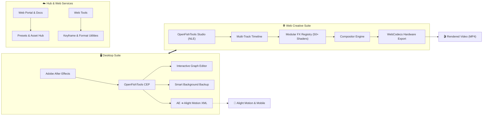

  

  # OpenFishTools

  ### *The Open-Source Creative Ecosystem for Motion Designers & Visual Artists*

  

    <strong>Bridging desktop power with modern, zero-latency client-side browser editing.</strong>
  

  

    
    
    
    
  

  

    <a href="#-about-openfishtools">About</a> •
    <a href="#-key-pillars">Key Pillars</a> •
    <a href="#-ecosystem">Ecosystem</a> •
    <a href="#-architecture--workflow">Workflow</a> •
    <a href="#-getting-started">Get Started</a> •
    <a href="#-community--support">Community</a>
  

---

## 🌊 About OpenFishTools

Traditional motion graphics and video editing workflows are frequently locked inside heavy proprietary software or throttled by expensive cloud rendering pipelines. 

**OpenFishTools** is built to rethink creative tooling:
- **Desktop Workflow Optimization**: Native extensions for Adobe After Effects that remove repetitive bottlenecks.
- **Pure Client-Side Video Creation**: High-performance browser-based non-linear editing using WebCodecs and GPU-accelerated canvas compositing.
- **Cross-Platform Portability**: Seamless conversion of desktop compositions to mobile animation environments (AE ➔ Alight Motion).

---

## ✨ Key Pillars

<table width="100%">
  <tr>
    <td width="50%" valign="top">
      <h3>⚡ 100% Client-Side & Private</h3>
      
Zero cloud render queues. Video encoding, frame compositing, and shader processing happen entirely on the user's hardware via WebCodecs and MP4-muxer. Your media never leaves your machine.

    </td>
    <td width="50%" valign="top">
      <h3>🎛️ Precision Curve & Motion Control</h3>
      
Professional Bezier easing graphs, real-time curve manipulators, and automated preset injections designed for animators who obsess over motion cadence and fluid timing.

    </td>
  </tr>
  <tr>
    <td width="50%" valign="top">
      <h3>🔄 Universal Composition Bridges</h3>
      
Direct translation pipeline from complex After Effects project hierarchies into lightweight mobile-compatible animation project files with recursive pre-composition nesting.

    </td>
    <td width="50%" valign="top">
      <h3>🧩 Modular Visual Effects Registry</h3>
      
A pluggable registry architecture featuring 50+ built-in optical, chromatic, distortion, and 3D transform modules with instant timeline parameter binding.

    </td>
  </tr>
</table>

---

## 📦 Ecosystem

OpenFishTools consists of specialized repositories designed to work seamlessly both standalone and together:

| Project | Role | Highlights | Repository |
| :--- | :--- | :--- | :---: |
|  **Studio** | **Web NLE & Motion Engine** | • Desktop AE-style layout & mobile touch canvas • Hardware-accelerated WebCodecs 4K/60fps export • Multi-track keyframe interpolation & curve editor • 50+ modular GPU shaders & visual effects | [**Open Studio**](https://github.com/openfishtools/Studio) |
|  **CEP** | **After Effects Panel Extension** | • Interactive Bezier curve easing graph with auto-apply • AE to Alight Motion (AM) composition XML converter • Smart non-disruptive auto-save backup system • Layer alignment, auto-crop, and utility tools | [**Open CEP**](https://github.com/openfishtools/CEP) |
|  **Web** | **Portal & Services Platform** | • Unified web platform, preset index, and documentation • Edge-deployed on Cloudflare Workers & Pages • Community templates, scripts, and asset library | [**Open Web**](https://github.com/openfishtools/web) |
|  **Web Tools** | **Lightweight Utilities** | • Rapid keyframe data converters & preset builders • Online animation calculators and asset formatters • Zero-install standalone browser helpers | [**Open Tools**](https://github.com/openfishtools/web-tools) |

---

## 🔁 Architecture & Workflow

---

## 🚀 Getting Started

Select the tool tailored to your workflow:

- **Using After Effects?**
  Head over to [**openfishtools/CEP**](https://github.com/openfishtools/CEP) and grab the one-click installer (`.pkg` for macOS or `.exe` for Windows).
- **Want to edit in the browser?**
  Check out [**openfishtools/Studio**](https://github.com/openfishtools/Studio) to run the zero-dependency local dev server and start editing immediately with client-side GPU export.
- **Looking for online tools and presets?**
  Visit [**openfishtools/web**](https://github.com/openfishtools/web) and [**openfishtools/web-tools**](https://github.com/openfishtools/web-tools).

---

## 🤝 Community & Contributing

We welcome contributions from motion designers, shader programmers, web developers, and creative minds!

- 🐛 **Found a bug?** Open an issue in the respective repository.
- 💡 **Have a feature idea?** Start a discussion or suggest a new modular effect.
- 🛠️ **Want to submit code?** Pull requests are warmly welcomed across all sub-projects.

---

  Crafted with passion for creators by <a href="https://github.com/cutefishaep"><strong>cutefishaep</strong></a> & the OpenFishTools community.

   

  

