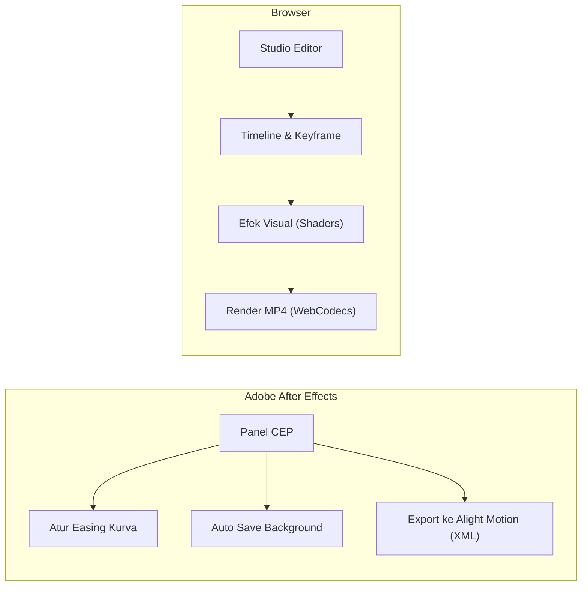

<div align="center">

  

  # OpenFishTools

  <p><strong>Tools gratis & open-source untuk motion design dan video editing.</strong></p>

  <p>
    <a href="https://github.com/openfishtools"></a>
    <a href="#license"></a>
    <a href="https://github.com/cutefishaep"></a>
  </p>

  <p>
    <a href="#-pilih-tool"><b>Pilih Tool</b></a> •
    <a href="#-daftar-project"><b>Daftar Project</b></a> •
    <a href="#-alur-kerja"><b>Alur Kerja</b></a> •
    <a href="#-cara-install--pakai"><b>Cara Pakai</b></a>
  </p>

</div>

---

### 🎮 Pilih Tool

Klik salah satu opsi di bawah untuk melihat ringkasan fiturnya:

<details open>
  <summary><b>🎬 Studio (Web Video Editor)</b></summary>
  <br>

  Aplikasi video editor berbasis web yang berjalan langsung di browser tanpa perlu server cloud:
  - **Tampilan**: Pilihan mode Desktop (gaya After Effects) & mode Mobile (layar sentuh).
  - **Multi-track Timeline**: Keyframe, kurva grafik, link parent, dan layer blend mode.
  - **Export Lokal**: Render MP4 60FPS langsung di browser memanfaatkan GPU dan WebCodecs.
  - **50+ Efek**: Dilengkapi berbagai efek visual siap pakai (glow, blur, shake, warp, 3D).

  👉 [**Buka Repository Studio**](https://github.com/openfishtools/Studio)
</details>

<details open>
  <summary><b>⚡ CEP (Ekstensi After Effects)</b></summary>
  <br>

  Panel ekstensi praktis untuk Adobe After Effects:
  - **Graph Editor**: Mengatur kurva easing Bezier dengan slider dan tombol preset instan.
  - **AE ke Alight Motion**: Mengubah komposisi AE menjadi file XML Alight Motion.
  - **Auto Save**: Backup otomatis di background tanpa mengganggu preview kerja.
  - **Utilitas Layer**: Quick anchor point, auto-crop pre-composition, dan screenshot layer.

  👉 [**Buka Repository CEP**](https://github.com/openfishtools/CEP)
</details>

<details>
  <summary><b>🌐 Web & Web Tools (Portal & Utilitas)</b></summary>
  <br>

  - **Web Platform**: Website dokumentasi, katalog aset, dan preset.
  - **Web Tools**: Alat bantu online ringan untuk kalkulasi dan konversi data animasi.

  👉 [**Buka Web**](https://github.com/openfishtools/web) • [**Buka Web Tools**](https://github.com/openfishtools/web-tools)
</details>

---

### 📦 Daftar Project

| Project | Platform | Fungsi | Link |
| :--- | :--- | :--- | :---: |
|  **Studio** | Web Browser | Video editor non-linear + timeline + export MP4 | [Lihat Code](https://github.com/openfishtools/Studio) |
|  **CEP** | Adobe After Effects | Panel kurva easing, converter Alight Motion, & auto-save | [Lihat Code](https://github.com/openfishtools/CEP) |
|  **web** | Website | Portal informasi dan dokumentasi | [Lihat Code](https://github.com/openfishtools/web) |
|  **web-tools** | Online Tools | Alat bantu konversi dan kalkulator animasi | [Lihat Code](https://github.com/openfishtools/web-tools) |

---

### 🔄 Alur Kerja



---

### 🚀 Cara Install & Pakai

<details>
  <summary><b>1. Pasang Ekstensi After Effects (CEP)</b></summary>
  <br>

  1. Unduh installer dari [Halaman Releases CEP](https://github.com/openfishtools/CEP/releases):
     - macOS: `OpenFishTools.pkg`
     - Windows: `OpenFishTools_Setup.exe`
  2. Buka After Effects, masuk ke menu **Window > Extensions > Fish Tools**.
</details>

<details>
  <summary><b>2. Menjalankan Studio di Komputer Lokal</b></summary>
  <br>

  ```bash
  git clone https://github.com/openfishtools/Studio.git
  cd Studio
  npm install
  npm start
  ```
  Buka browser di alamat `http://localhost:3000/desktop.html` (Desktop) atau `http://localhost:3000/editor.html` (Mobile).
</details>

---

<div align="center">
  <sub>Dibuat oleh <a href="https://github.com/cutefishaep"><strong>cutefishaep</strong></a>. Lisensi MIT.</sub>
</div>
